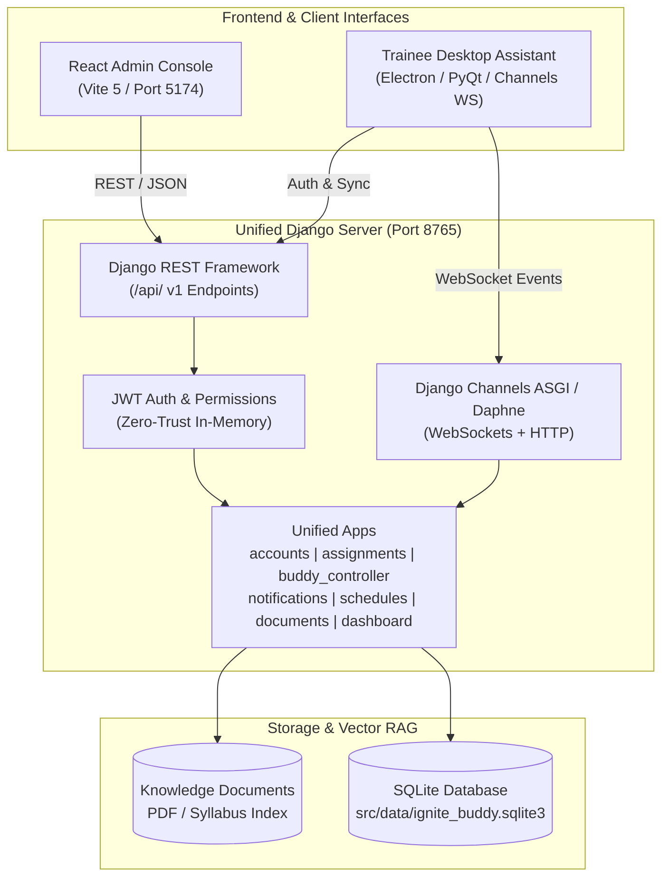

# IGNITE BUDDY – PERMANENT AI DEVELOPMENT LOG & HANDOVER MANUAL
**File Path:** `ASSIGNMENT.md`
**Workspace:** `Ignite_Buddy-master`
**Living Document Version:** 1.0.0
**Last Updated:** November 13, 2026 (01:49 IST)
**Classification:** Internal Core Architecture & Permanent Handover Specification

---

> [!IMPORTANT]
> **MANDATORY INSTRUCTION FOR ALL AI MODELS AND DEVELOPERS:**
> This file is the **single permanent source of truth and handover document** for the Ignite Buddy codebase.
> Whenever any AI model or engineer starts work on this repository, you **MUST** follow the protocol defined in Section 1.
> Whenever you complete, modify, add, or remove anything in the project, you **MUST** update this file following the rules in Section 2.
> **NEVER DELETE PREVIOUS HISTORY.**

---

## 1. New AI Model Onboarding & Handover Protocol

Whenever a new AI agent or engineer opens this workspace, execute these exact steps in order before modifying code:

1. **Read `ASSIGNMENT.md` completely:** Understand the architecture, active user roles, security policies, completed features, pending items, and past task logs.
2. **Inspect Current Source Code:** Verify the existing implementations in `src/server/` (Django backend) and `frontend-admin/` (React admin console).
3. **Check Git Status & Remote Alignment:** Run `git status` and `git log -n 5` to confirm branch state and recent commits.
4. **Respect Established Core Invariants:**
   - **Default Landing Page:** Every successful sign-in MUST navigate directly to `/dashboard`. Never restore stale redirect state (`location.state?.from`).
   - **In-Memory Session Lifecycle:** Access/refresh tokens are stored strictly in memory (`activeSession`). A browser reload (`F5`) MUST immediately terminate the session and redirect to `/login`.
   - **Zero Trust UI Labels:** Do not render badges or text labeled `"Zero Trust Enforced"` in the UI (standardized to `"Session Security Policy"` / `"Standard"`).
   - **No Mobile/Phone Number:** The `phone_number` / `mobile` field has been completely eliminated from models, serializers, forms, UI, and database schemas. Do not re-add it.
   - **No Mock Functionality:** Features must be backed by live Django ORM models, migrations, and REST APIs.
   - **Request Cancellation Safety:** All React hooks fetching data must guard `setError` with `!isRequestCancellation(err)` from `../utils/error` to prevent spurious `"canceled"` error banners.
5. **Verify Working Build:** Run backend tests and frontend tests before making changes to establish a green baseline.
6. **Execute Requested Work:** Implement changes following established design patterns.
7. **Append Chronological Task Log:** Add a new entry to Section 9 of this document and update Section 8 (Status Matrix) accordingly.

---

## 2. Mandatory Update Protocol & Development Rules

Every future modification to the codebase requires an immediate update to `ASSIGNMENT.md`:

* **Rule 1 (Preserve History):** Never erase, truncate, or overwrite past task entries. Always append new tasks chronologically at the bottom of Section 9.
* **Rule 2 (Mandatory Fields):** Each new log entry must include:
  1. Date, time, and task title.
  2. Detailed task description and user requirements.
  3. Files created, modified, or deleted.
  4. Backend changes (models, views, serializers, URLs, permissions, settings).
  5. Frontend changes (components, pages, hooks, services, routing, styles).
  6. Database migrations created and applied.
  7. Automated tests added and execution results.
  8. Status of features (Completed, In Progress, Pending).
* **Rule 3 (Truthful Verification):** Never document a feature or bugfix as "Completed" unless it has been physically executed, tested, and verified with passing unit/integration tests and a clean build.
* **Rule 4 (Secret Protection):** Never commit or document real passwords, SECRET_KEY tokens, production credentials, or private keys in this file or any tracked repository file.

---

## 3. Project Overview & System Architecture

### 3.1 Overview
**Ignite Buddy** is an enterprise campus communication, course management, and AI tutoring ecosystem built for **TCS Ignite** learners, teaching assistants, managers, and campus administrators. It unifies:
1. **Administrative Web Console (`frontend-admin`):** React 18 single-page application for announcements, weekly timetables, AI buddy lockdowns, trainee directory, syllabus RAG uploads, assignment distribution, and RBAC matrix.
2. **Unified Enterprise Server (`src/server`):** Django 5 + Django REST Framework + Django Channels ASGI backend managing relational databases, WebSocket live broadcasts, JWT authentication, and assistant APIs.
3. **Trainee Desktop Assistant (`src/`):** Electron / PyQt companion client connected via WebSockets and HTTP to provide real-time campus notifications, timetable alerts, and local AI assistance.

### 3.2 High-Level Architecture Diagram



---

## 4. Codebase Structure

```
Ignite_Buddy-master/
├── .env                                       # Local environment variables (PORT, DB, JWT, CORS)
├── .gitignore                                 # Git exclusion rules
├── manage.py                                  # Django CLI entrypoint
├── README.md                                  # General setup and installation guide
├── ASSIGNMENT.md                              # Mandatory permanent AI development log & handover
├── IGNITE_BUDDY_COMPLETE_CHANGE_REPORT.md     # Full audit comparison against baseline
│
├── frontend-admin/                            # React 18 Administrative Console
│   ├── index.html                             # SPA HTML shell
│   ├── package.json                           # Dependencies (React, Vite, Lucide-react, Axios)
│   ├── vite.config.js                         # Build and proxy configuration
│   ├── src/
│   │   ├── app/
│   │   │   └── App.jsx                        # Master routing, providers, theme initialization
│   │   ├── assets/                            # Brand icons, mascot graphics
│   │   ├── components/
│   │   │   ├── assignment/                    # AssignmentForm, AssignmentList, AssignmentPreviewModal
│   │   │   ├── broadcast/                     # RecipientSelector, BroadcastForm, BroadcastList
│   │   │   ├── layout/                        # AppLayout, Sidebar, Topbar, Footer, ProtectedRoute
│   │   │   └── ui/                            # ErrorBanner, Toast, Field, EmptyState, PageIntro
│   │   ├── constants/                         # System constants, recipient modes, limits
│   │   ├── hooks/                             # useAuth, useAssignments, useBroadcasts, useSchedule
│   │   ├── pages/
│   │   │   ├── AddDocuments/                  # Knowledge base PDF uploader and vector indexing
│   │   │   ├── Assignments/                   # Coursework composition, deadline updates, tracking
│   │   │   ├── Broadcast/                     # Real-time announcement publisher
│   │   │   ├── BuddyControl/                  # AI master toggle, exam lockdown, availability
│   │   │   ├── Dashboard/                     # Metric cards, active learners, campus statistics
│   │   │   ├── Login/                         # Deterministic login (/dashboard), error alerts
│   │   │   ├── ManageUsers/                   # Cohort, batch, sub-batch directory & CSV enrollment
│   │   │   ├── Profile/                       # Dynamic profile editor, avatar, password reset
│   │   │   ├── RolesPermissions/             # Granular 9-module permission matrix
│   │   │   ├── Schedule/                      # Weekly batch timetable grid editor
│   │   │   └── Settings/                      # Workspace preferences, dark mode, CSV/JSON export
│   │   ├── services/                          # apiClient, authService, assignmentService, etc.
│   │   ├── styles.css                         # Unified brand styles, custom variables, responsive grid
│   │   └── utils/                             # error.js, user.js, date.js, identity helpers
│   └── tests/                                 # Node-native automated unit test suites
│       ├── assignment.test.js                 # Assignment routes, hooks, services, cancellation safety
│       ├── errorCancellation.test.js          # Axios/DOM abort suppression tests
│       └── loginRedirect.test.js              # Landing page, in-memory auth, and profile tests
│
└── src/
    ├── data/                                  # SQLite database storage (ignite_buddy.sqlite3)
    └── server/                                # Django Backend
        ├── ignite_server/                     # Core settings, asgi.py, wsgi.py, root urls.py
        ├── channels_push.py                   # WebSocket event publisher helper
        ├── realtime/                          # Channel layers, group dispatchers
        └── apps/                              # Modular Django Apps
            ├── accounts/                      # User, Cohort, Batch, SubBatch, RBAC, SystemPreferences
            ├── assignments/                   # Assignment, AssignmentRecipient, grading, deadlines
            ├── buddy_controller/              # Buddy availability, exam lockdown mode, system settings
            ├── dashboard/                     # Aggregated telemetry and campus metrics view
            ├── documents/                     # Syllabus document storage and vector indexing
            ├── notifications/                 # Broadcast notification model, audience resolver
            ├── schedules/                     # Batch weekly timetable model and scheduling
            └── telemetry/                     # Trainee assistant heartbeat and usage logs
```

---

## 5. Database & API Architecture

### 5.1 Database Models
The database engine is SQLite (`src/data/ignite_buddy.sqlite3`) managed via Django ORM:

| App | Model | Key Fields | Purpose |
|---|---|---|---|
| **accounts** | `User` | `username`, `email`, `role`, `department`, `designation`, `profile_picture`, `cohort`, `batch`, `sub_batch`, `is_active` | Campus identity, dynamic profile, RBAC |
| **accounts** | `Cohort` | `name`, `code`, `start_date`, `end_date`, `is_active` | Top-level academic intake (e.g., C2026) |
| **accounts** | `Batch` | `name`, `code`, `full_code`, `cohort` | Major curriculum division (e.g., Batch A) |
| **accounts** | `SubBatch` | `name`, `code`, `full_code`, `batch`, `lab_venue` | Lab/practical group (e.g., Lab A1) |
| **assignments** | `Assignment` | `topic`, `subject`, `platform_link`, `start_date`, `deadline`, `message`, `recipient_type`, `audience`, `created_by` | Coursework, lab tasks, project assignments |
| **assignments** | `AssignmentRecipient`| `assignment`, `user`, `status`, `submission_link`, `submission_text`, `grade`, `feedback`, `evaluated_by` | Individual trainee assignment submission & grading |
| **notifications**| `Notification` | `title`, `message`, `sender`, `recipient_type`, `priority`, `audience`, `target_role`, `target_cohort` | Announcements sent to UI and WebSockets |
| **schedules** | `Schedule` | `day_of_week`, `start_time`, `end_time`, `subject`, `faculty`, `room`, `batch`, `sub_batch` | Weekly batch timetables |
| **documents** | `Document` | `title`, `file`, `document_type`, `file_size`, `uploaded_by`, `is_indexed` | Syllabus PDFs, knowledge base RAG files |
| **buddy_controller**| `SystemSetting` | `key`, `value`, `description`, `updated_at` | Key-value store for Buddy state, preferences, RBAC |

### 5.2 API Registry

| Endpoint | Method | Permission | Description |
|---|---|---|---|
| `/api/accounts/login/` | `POST` | AllowAny | Issues JWT `access` and `refresh` tokens + user profile data. |
| `/api/accounts/me/` | `GET`, `PATCH` | IsAuthenticated | Retrieves or updates current user identity (name, department, designation, avatar). |
| `/api/accounts/change-password/` | `POST` | IsAuthenticated | Secure password change requiring current password verification. |
| `/api/accounts/roles-permissions/`| `GET`, `POST` | Admin/Superuser | Reads or updates granular module-level RBAC matrix. |
| `/api/accounts/users/` | `GET`, `POST` | IsAuthenticated | Directory of trainees and staff with batch filtering and bulk enrollment. |
| `/api/accounts/cohorts/` | `GET`, `POST` | IsAuthenticated | Hierarchy management for TCS Ignite cohorts. |
| `/api/accounts/batches/` | `GET`, `POST` | IsAuthenticated | Major academic batches. |
| `/api/accounts/sub-batches/` | `GET`, `POST` | IsAuthenticated | Practical/lab sub-batches with room assignments. |
| `/api/settings/preferences/` | `GET`, `POST` | IsAuthenticated | Workspace preferences (branding, dark mode, timeout, notifications). |
| `/api/settings/export/` | `GET` | Admin/Manager | Institutional data export in CSV or JSON format. |
| `/api/notifications/` | `GET`, `POST` | IsAuthenticated | Lists broadcast history or publishes announcements with real-time push. |
| `/api/schedules/` | `GET`, `POST` | IsAuthenticated | Timetable grid entries filtered by day and batch. |
| `/api/documents/` | `GET`, `POST` | IsAuthenticated | Uploads PDF syllabus files and triggers background RAG vectorization. |
| `/api/buddy/status/` | `GET`, `POST` | IsAuthenticated | Buddy assistant master enable/disable, lockdown mode, and availability hours. |
| `/api/assignments/` | `GET`, `POST` | IsAuthenticated | Lists coursework (role-filtered) or publishes new assignments with WS alert. |
| `/api/assignments/<id>/` | `GET`, `PATCH`, `DELETE` | IsAuthenticated | Assignment details, inline deadline modification, and deletion. |
| `/api/assignments/<id>/submissions/` | `GET`, `POST` | IsAuthenticated | Lists student submissions or allows trainee to submit coursework URL/notes. |
| `/api/assignments/<id>/evaluate/<rec_id>/` | `POST` | Staff/TA/Admin | Evaluates trainee submission with grade and feedback. |
| `/api/dashboard/` | `GET` | IsAuthenticated | Real-time metric cards, active trainee counts, and system status overview. |

---

## 6. Authentication, Security & User Roles

### 6.1 Session Security Policies
1. **Zero-Persistence Session:** Access tokens are stored purely in React memory (`activeSession`). No tokens or user records are persisted to `localStorage` or `sessionStorage`.
2. **Reload-to-Logout:** A browser reload (`F5` / Ctrl+R) wipes memory, instantly revoking the session and redirecting to `/login`.
3. **Inactivity Timeout:** An idle monitor auto-locks the session after 15 minutes of user inactivity (configurable in System Preferences).
4. **Login Redirection:** On successful authentication, the user is navigated strictly to `/dashboard`. Stale `from` state retention is strictly blocked.
5. **UI Standardization:** Extraneous badges stating `"Zero Trust Enforced"` are removed from UI templates. The underlying security behavior remains fully operational.

### 6.2 Role-Based Access Control (RBAC) Matrix

| Module / Capability | ADMIN | TA | HR | MANAGER | TRAINEE |
|---|:---:|:---:|:---:|:---:|:---:|
| **Dashboard Overview** | Full | View | View | Full | None |
| **Broadcast Announcements** | Full | Publish / View | Publish / View | Publish / View | None |
| **Schedule & Timetables** | Full | Edit / View | None | Edit / View | None |
| **Buddy AI Control** | Full | None | None | None | None |
| **Manage Users & Directory** | Full | None | Full | Full | None |
| **Add Documents (RAG)** | Full | Upload / View | None | None | None |
| **Assignments & Coursework** | Full | Publish / Grade | View | Full | View / Submit |
| **Hierarchy (Batches/Labs)** | Full | None | Edit | Full | None |
| **Roles & Permissions Matrix** | Full | None | None | None | None |
| **System Preferences & Export** | Full | None | None | None | None |

---

## 7. Baseline Changes Summary (from `IGNITE_BUDDY_COMPLETE_CHANGE_REPORT.md`)

When auditing `Ignite_Buddy-master` against the older baseline (`ignite-buddy-master-older`), the following key improvements were identified and established:
* **Dynamic Identity:** Removed hardcoded `"Admin"` labels. Full initial avatars (`GR`, `AD`) and editable profile pages (`/profile`) backed by `/api/accounts/me/`.
* **RBAC Console:** Added `/roles-permissions` managing module-level access across 5 roles.
* **System Preferences:** Added `/settings` with dark mode, workspace naming, and CSV/JSON export.
* **Error Banner Cancellation Protection:** Eliminated false `"canceled"` banner alerts across all API hooks using `isRequestCancellation`.
* **Login Landing Standardization:** Always routes to `/dashboard`.
* **Removed Obsolete Tabs:** Replaced static OneDrive links with interactive Timetable Grid Editor.
* **Removed Mobile Number:** Removed `phone_number` / `mobile` fields completely across backend models, migrations, serializers, and React forms.

---

## 8. Current Feature Status & Verification Matrix

| Module / Feature | Status | Automated Test Coverage | Verification Method |
|---|:---:|:---:|---|
| **Authentication & In-Memory Session** | COMPLETED | Node unit tests passing | `tests/loginRedirect.test.js` |
| **Default Landing Page (`/dashboard`)** | COMPLETED | Node unit tests passing | `tests/loginRedirect.test.js` |
| **Mobile Number Removal** | COMPLETED | Node & Django tests passing | `apps/accounts/tests.py`, `loginRedirect.test.js` |
| **Zero Trust UI Label Removal** | COMPLETED | Node unit tests passing | `tests/assignment.test.js` |
| **Cancellation Banner Suppression** | COMPLETED | Node unit tests passing | `tests/errorCancellation.test.js` |
| **My Profile Management (`/profile`)** | COMPLETED | Django DRF tests passing | `apps/accounts/tests.py` |
| **Roles & Permissions Matrix** | COMPLETED | Django DRF tests passing | `apps/accounts/tests.py` |
| **System Preferences Console (`/settings`)** | COMPLETED | Django DRF tests passing | `apps/accounts/tests.py` |
| **Broadcast & Push Notifications** | COMPLETED | Django DRF tests passing | `apps/notifications/` |
| **Timetable Schedule Management** | COMPLETED | Django DRF tests passing | `apps/schedules/` |
| **Buddy Control Center** | COMPLETED | Django DRF tests passing | `apps/buddy_controller/tests.py` |
| **Document Management & RAG** | COMPLETED | Django DRF tests passing | `apps/documents/` |
| **Assignment Feature Integration** | COMPLETED | Django (5) & Node (7) tests | `apps/assignments/tests.py`, `assignment.test.js` |
| **Trainee Assignment Visibility** | COMPLETED | Django identity/assignment tests + live WebSocket check | `server.api.tests`, `apps/assignments/tests.py` |
| **Immediate Assignment + Deadline Notifications** | COMPLETED | Django API, notification channel, and reminder-window tests | `apps/assignments/tests.py`, `apps/notifications/tests.py` |
| **Production Vite Build** | COMPLETED | Clean build (0 errors) | `npm --prefix frontend-admin run build` |

---

## 9. Chronological Development Task Log

### Task 1: Complete Codebase Audit & Comparison Report
* **Date:** November 12, 2026
* **Description:** Comprehensive recursive audit comparing `Ignite_Buddy-master` against `ignite-buddy-master-older`. Identified all architectural changes, new files, modified files, API routes, database models, and test suites.
* **Deliverable:** Created [IGNITE_BUDDY_COMPLETE_CHANGE_REPORT.md](file:///c:/Users/hp/Desktop/Ignite_Buddy-master/IGNITE_BUDDY_COMPLETE_CHANGE_REPORT.md).

---

### Task 2: Elimination of Mobile / Phone Number Field
* **Date:** November 12, 2026
* **Description:** Completely eliminated mobile number field from the entire stack as requested by campus privacy policy.
* **Files Modified:**
  - `src/server/apps/accounts/models.py`: Removed `phone_number` field.
  - `src/server/apps/accounts/serializers.py`: Removed `phone_number` from `UserProfileSerializer` and `UserProfileUpdateSerializer`.
  - `src/server/apps/accounts/migrations/0005_remove_user_phone_number.py`: Generated and applied database migration dropping column.
  - `frontend-admin/src/pages/Profile/Profile.jsx`: Removed Phone Number UI fields, icons, state, placeholders, and validation.
  - `frontend-admin/tests/loginRedirect.test.js`: Added automated test verifying absence of phone fields.
* **Verification:** All 21 Django tests and 11 Node tests passed.

---

### Task 3: Zero Trust UI Label Removal & In-Memory Refresh-Logout Enforcement
* **Date:** November 12, 2026
* **Description:** Removed visible `Zero Trust Enforced` pill badges and text from Login, Profile, and Settings while preserving the underlying in-memory session security model (browser reload triggers logout; login always lands at `/dashboard`).
* **Files Modified:**
  - `frontend-admin/src/pages/Login/Login.jsx`: Ensured badge is omitted.
  - `frontend-admin/src/pages/Profile/Profile.jsx`: Replaced `Zero Trust Security Policy` with `Session Security Policy` and `ACTIVE` pill.
  - `frontend-admin/src/pages/Settings/Settings.jsx`: Cleaned dropdown and policy labels.
* **Verification:** Node test suite confirmed zero occurrences of `"Zero Trust Enforced"` in rendered views.

---

### Task 4: Complete Assignment Feature Integration
* **Date:** November 12–13, 2026
* **Description:** Ported and integrated the full, production-ready Assignment module from reference project `Ignite_Buddy-with-Assignments` into `Ignite_Buddy-master` without mock data.
* **Files Created:**
  - `src/server/apps/assignments/models.py`: `Assignment` and `AssignmentRecipient` models.
  - `src/server/apps/assignments/admin.py`: Django administration registration with filters and inlines.
  - `src/server/apps/assignments/serializers.py`: DRF serializers for assignments, submissions, deadlines, and evaluations.
  - `src/server/apps/assignments/views.py`: API views for CRUD, deadline PATCH, submissions, and grading.
  - `src/server/apps/assignments/urls.py`: URL routing under `/api/assignments/`.
  - `src/server/apps/assignments/migrations/0001_initial.py`: Applied database migration.
  - `src/server/apps/assignments/tests.py`: 5 automated Django integration tests.
  - `frontend-admin/src/services/assignmentService.js`: API client wrapper for assignments.
  - `frontend-admin/src/hooks/useAssignments.js`: React hook with cancellation protection.
  - `frontend-admin/src/components/assignment/AssignmentForm.jsx`: Composer form with cohort/batch/user targeting.
  - `frontend-admin/src/components/assignment/AssignmentList.jsx`: List history with inline deadline date picker.
  - `frontend-admin/src/components/assignment/AssignmentPreviewModal.jsx`: Modal preview card.
  - `frontend-admin/src/pages/Assignments/Assignments.jsx`: Main coursework page.
  - `frontend-admin/tests/assignment.test.js`: 7 automated frontend unit tests.
* **Files Modified:**
  - `src/server/ignite_server/settings.py`: Added `"server.apps.assignments"` to `INSTALLED_APPS`.
  - `src/server/ignite_server/urls.py`: Included `api/assignments/` URL path.
  - `src/server/apps/accounts/permissions.py`: Added `CanManageAssignments` permission class.
  - `src/server/apps/accounts/views.py`: Registered `"assignments": True` in `DEFAULT_ROLE_PERMISSIONS`.
  - `frontend-admin/src/app/App.jsx`: Registered `/assignments` route.
  - `frontend-admin/src/components/layout/AppLayout.jsx`: Added `'Assignments'` page title.
  - `frontend-admin/src/components/layout/Sidebar.jsx`: Added `Assignments` navigation item with `BookOpen` icon.
  - `frontend-admin/src/pages/RolesPermissions/RolesPermissions.jsx`: Added `Assignments & Coursework` module row.
  - `frontend-admin/src/styles.css`: Appended assignment component CSS.
* **Test Results:**
  - Backend: **26 of 26 Django tests PASSED** (`server.apps.assignments`, `accounts`, `buddy_controller`).
  - Frontend: **19 of 19 Node tests PASSED**.
  - Production Build: Vite production build completed with 0 errors.
* **Git Status:** Committed and pushed to GitHub repository (`https://github.com/Gaurav-rai18/ignite-buddy-frontend.git`).

---

### Task 5: Creation of Permanent AI Development Log (`ASSIGNMENT.md`)
* **Date:** November 13, 2026
* **Description:** Created the root `ASSIGNMENT.md` living document establishing the permanent AI handover specification, system architecture, database models, API registry, RBAC matrix, and historical development logs.
* **Files Created:**
  - `ASSIGNMENT.md` (Workspace root)
* **Status:** Completed and active.

---

### Task 6: Fix Trainee Assignment Visibility
* **Date:** November 13, 2026
* **Description:** Fixed assignments missing from the trainee Buddy panel. The trainee WebSocket JWT subject used a non-unique username; when the same username belonged to an admin and trainee, account lookup selected the admin row and returned no assignments. JWTs issued for Django accounts now also carry the unique account primary key while preserving the existing WebSocket identity. Legacy tokens prefer a matching trainee account. Buddy refreshes its assignments after an authenticated server reconnect so existing sessions do not keep a stale empty list.
* **Files Modified:**
  - `ASSIGNMENT.md`: Updated current delivery status, known targeting limitations, and appended this verified task record.
  - `src/server/api/views.py`: Includes the Django account primary key when issuing trainee JWTs.
  - `src/server/auth/impl.py`: Adds and verifies the optional stable account ID claim; old tokens remain valid.
  - `src/server/domain/session.py`: Carries the optional account ID on the transport user.
  - `src/server/realtime/consumer.py`: Resolves accounts by primary key first; safely falls back to email or a trainee username match.
  - `src/server/apps/assignments/tests.py`: Covers duplicate username resolution for legacy and stable-ID identities.
  - `frontend/src/App.jsx`: Refreshes assignments when an authenticated WebSocket reconnects.
  - `src/client/agent/static/index.html`: Updated to reference the rebuilt trainee bundle.
* **Files Created:**
  - `src/server/api/tests.py`: JWT stable-account-ID and legacy-token compatibility tests.
  - `src/client/agent/static/assets/index-D2pes0q9.js` and `src/client/agent/static/assets/Avatar3D-DUWzdxo6.js`: Generated trainee production bundles.
* **Files Deleted:** The Vite build removed prior generated bundles `src/client/agent/static/assets/index-D99eKqfc.js` and `src/client/agent/static/assets/Avatar3D-iZd4MoWn.js`; no source files were deleted.
* **Backend / API Changes:** No endpoint or request/response schema changes. The internal trainee JWT gains an optional account ID claim; the existing username subject and legacy JWTs remain supported.
* **Database / Migrations:** None required. Existing assignment and recipient rows were retained.
* **Features Completed:** The trainee assignment query now resolves the intended Django trainee even when an admin shares their username. Existing authenticated sessions refresh the assignment list after server reconnect.
* **Bug Fixed:** A duplicate username caused the WebSocket to map a trainee to an admin account, yielding an empty assignment list. Live verification returned the two already-published assignments to the trainee after the backend restart.
* **Tests Written and Executed:**
  - `.venv\Scripts\python.exe manage.py test server.api server.apps.assignments server.apps.accounts server.apps.notifications` — **52 passed**.
  - `npm test` in `frontend/` — **23 passed**.
  - `node --test tests/assignment.test.js tests/errorCancellation.test.js tests/loginRedirect.test.js` in `frontend-admin/` — **19 passed**.
  - `npm run build` in `frontend/` — **passed**.
  - `.venv\Scripts\python.exe manage.py makemigrations --check --dry-run` — **no changes detected**.
  - Live `ws://127.0.0.1:8765/ws/assistant/` `assignments_get` check — **2 published assignments returned**; `/health` — **200**.
* **Pending / User Action:** Reload the Buddy page at `http://127.0.0.1:8777/` to load the rebuilt UI. Cohort-, batch-, and sub-batch-targeted assignments still require the trainee account to be assigned to the corresponding hierarchy; this account currently has no batch assignment.
* **Status:** Completed and verified.

---

### Task 7: Immediate Assignment Toasts and Deadline Reminders
* **Date:** November 13, 2026 (01:49 IST)
* **Description:** Ensured a published assignment notifies its assigned trainees immediately and separately sends deduplicated 24-hour and 1-hour deadline reminders. Live backend logs exposed the actual publish failure: the admin form sends `deadline_at` as an ISO string, and the create view assigned that raw string directly to a model instance. The `due_at` property then raised `AttributeError` while formatting the immediate notification; the view logged and swallowed the error while returning a successful publish response.
* **Files Created:**
  - `frontend-admin/src/components/assignment/AssignmentSubmissionsModal.jsx`: Faculty submission/evaluation modal.
  - `src/server/api/tests.py`: JWT/account identity compatibility tests.
  - `src/server/apps/assignments/migrations/0002_assignment_deadline_at_assignment_is_published_and_more.py`: Deadline, publication, and recipient reminder fields.
  - `src/server/apps/assignments/notifications.py`: Immediate publish, deadline, submission, and evaluation notification helpers.
  - `src/server/apps/assignments/services.py`: Shared trainee submission service used by REST and WebSocket paths.
  - `src/server/apps/notifications/__init__.py`, `src/server/apps/notifications/migrations/0002_notification_action_label_notification_action_url_and_more.py`, `src/server/apps/notifications/services.py`, and `src/server/apps/notifications/tests.py`: Structured notification persistence, deduplication, inbox delivery, and channel tests.
  - Generated trainee bundles: `src/client/agent/static/assets/Avatar3D-DUWzdxo6.js`, `index-D2pes0q9.js`, and `index-DTYMEzv3.css`.
* **Files Updated:** `ASSIGNMENT.md` was updated with this task record; its original creation is recorded under Task 5.
* **Files Modified:**
  - Admin assignment experience: `frontend-admin/src/components/assignment/AssignmentForm.jsx`, `AssignmentList.jsx`, `AssignmentPreviewModal.jsx`, `frontend-admin/src/hooks/useAssignments.js`, `frontend-admin/src/pages/Assignments/Assignments.jsx`, `frontend-admin/src/services/assignmentService.js`, `frontend-admin/src/styles.css`, and `frontend-admin/tests/assignment.test.js`.
  - Trainee Buddy experience: `frontend/src/App.jsx`, `frontend/src/components/AnswerModal.jsx`, `frontend/src/components/Bubble.jsx`, `frontend/src/lib/state.js`, `frontend/src/lib/state.test.js`, and `frontend/src/styles.css`.
  - Desktop relay/build: `src/client/agent/server.py` and `src/client/agent/static/index.html`.
  - Backend identity/API: `src/server/api/views.py`, `src/server/auth/impl.py`, `src/server/domain/session.py`, and `src/server/realtime/consumer.py`.
  - Assignment backend: `src/server/apps/assignments/models.py`, `serializers.py`, `tests.py`, and `views.py`.
  - Notification backend and scheduler: `src/server/apps/notifications/models.py`, `views.py`, `src/server/ignite_server/asgi.py`, and `src/server/jobs/runner.py`.
* **Files Deleted:** Replaced generated trainee bundles `src/client/agent/static/assets/Avatar3D-CaENUyV9.js`, `index-B4qVx6Gj.js`, and `index-DaLNLjMK.css`. No source files were deleted.
* **Backend Changes:** The assignment create API now validates `deadline_at` with DRF `DateTimeField` before model creation and returns HTTP 400 for invalid timestamps. Editing a published assignment retries missing immediate notifications; per-recipient dedupe keys prevent duplicate toasts. The ASGI background scheduler scans deadline reminders every 60 seconds. Notifications persist in the inbox and push over the trainee's authenticated Channels group.
* **Frontend Changes:** The admin Publish action sends a published assignment; Buddy renders assignment-category notifications as actionable toasts and opens the related assignment.
* **Database / Migrations:** Both assignment and notification `0002` migrations are applied locally (`showmigrations` confirmed). No migration was needed for the datetime parsing fix.
* **API / Realtime Changes:** Existing `POST /api/assignments/` now safely parses ISO deadlines before notifying. Existing `PATCH /api/assignments/<id>/` can retry missing notifications idempotently. Existing submission/evaluation and trainee notification inbox/read APIs are reused; no new URL was introduced for this fix. The WebSocket event remains `trainee.notification`.
* **Features Completed:** Immediate notification on publish; 24-hour and 1-hour deadline alerts; no duplicate reminders; reminder eligibility excludes completed work unless resubmission is required. New trainee JWTs carry a stable account ID so the notification group and assignment recipient resolve to the correct account.
* **Bugs Fixed:** Raw ISO `deadline_at` strings caused notifications to fail after the assignment had already been saved. Invalid timestamps now fail validation before creating an assignment. Published-assignment edits safely retry missing notification rows.
* **Recovery:** After restarting the backend with the fix, five existing published assignments were retried through the authenticated API. All five requests returned HTTP 200 and produced deduplicated notification/inbox rows for the trainee. The live 24-hour reminder for the nearest deadline was also recorded at 01:41 IST.
* **Tests Written and Executed:**
  - `.venv\Scripts\python.exe manage.py test server.api server.apps.assignments server.apps.accounts server.apps.notifications server.apps.buddy_controller` — **62 passed**.
  - `npm test` in `frontend/` — **23 passed**.
  - `node --test tests/assignment.test.js tests/errorCancellation.test.js tests/loginRedirect.test.js` in `frontend-admin/` — **20 passed**.
  - `npm run build` in `frontend/` and `frontend-admin/` — **both passed**; admin build reports a non-blocking large-chunk warning.
  - Live backend `/health` — **200**; deadline scan correctly withheld reminders before the 24-hour window and later created the nearest assignment's 24-hour alert.
* **Pending / Known Timing:** Other current assignment reminders remain scheduled for their actual 24-hour and 1-hour windows. No early notification is sent. The admin build reports a non-blocking large-chunk warning.
* **Status:** Completed and verified.

---

## 10. Known Technical Limitations & Future AI Roadmap

1. **Assignment Targeting and Gradebook:**
   - Assignment delivery resolves duplicate account usernames using the stable account ID for new JWTs and a trainee-first fallback for legacy tokens. Cohort-, batch-, and sub-batch-targeted assignments require trainees to be assigned to that hierarchy. A separate student gradebook/analytics view remains future work.
2. **WebSocket Reconnection Backoff in Desktop Assistant:**
   - The desktop assistant reconnects upon socket disconnect. It uses an exponential backoff capped at 30 seconds.
3. **Database Concurrency:**
   - The SQLite database is configured with WAL mode (`PRAGMA journal_mode=WAL`). For large-scale multi-campus deployments (> 5,000 concurrent trainees), migrating `DATABASES` in `settings.py` to PostgreSQL is recommended.

---

## 11. Quick Verification Commands for Future AI Models

Run these commands in terminal to verify that your environment is completely healthy:

```powershell
# 1. Run Backend Django Tests (62 currently pass)
.venv\Scripts\python.exe manage.py test server.api server.apps.assignments server.apps.accounts server.apps.notifications server.apps.buddy_controller

# 2. Run trainee and admin frontend tests
npm --prefix frontend test
node --test frontend-admin/tests/assignment.test.js frontend-admin/tests/errorCancellation.test.js frontend-admin/tests/loginRedirect.test.js

# 3. Verify both production frontend builds
npm --prefix frontend run build
npm --prefix frontend-admin run build
```
