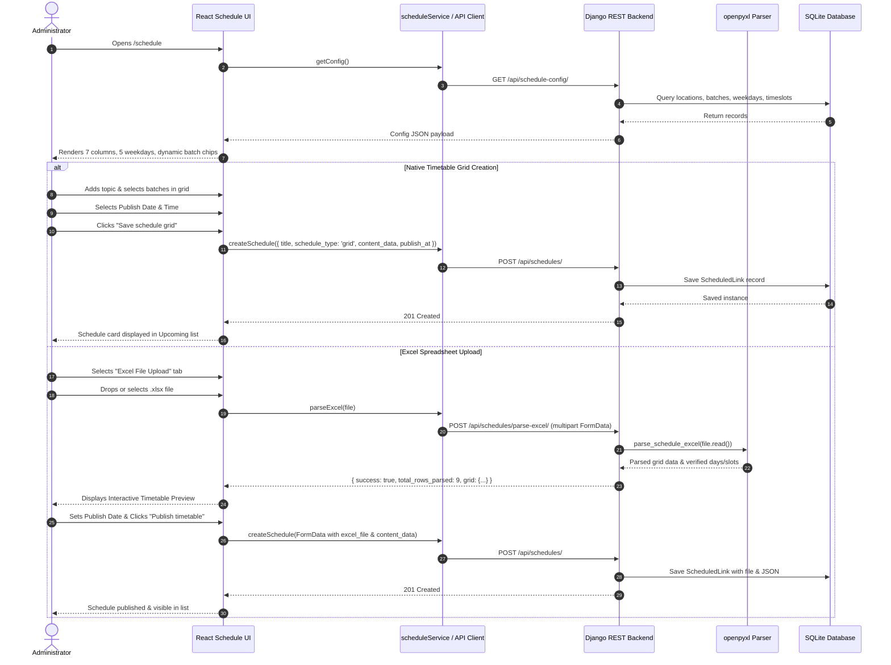

# Schedule Feature Documentation

## Overview
The **Schedule** feature in the Campus Admin Panel provides administrators with a full‑featured, dynamic UI and backend architecture to create, preview, and publish academic timetables. It supports two primary schedule publishing options:
1. **Native Timetable Grid** – an interactive, fully dynamic 7-location lab timetable grid with runtime-configurable batch groups (A, B, C, D…), sub-batches (A1–A5…), and custom time slots.
2. **Excel File Upload** – a spreadsheet upload workflow supporting `.xlsx` and `.xls` files with automatic structure validation, error handling, interactive timetable preview, and an official downloadable template.

The implementation connects a **React/Vite** frontend with a **Django REST Framework** backend and persistent SQLite database.

---

## Table of Contents
1. [Key Features & Capabilities](#key-features--capabilities)
2. [Frontend Architecture & Files](#frontend-architecture--files)
3. [Backend Architecture & Files](#backend-architecture--files)
4. [Data Flow & Sequence](#data-flow--sequence)
5. [Database Schema & Models](#database-schema--models)
6. [API Endpoints](#api-endpoints)
7. [Step-by-Step Usage Guide](#step-by-step-usage-guide)
8. [Testing & Verification](#testing--verification)

---

## Key Features & Capabilities

### 1. Seven Working Locations
The schedule grid displays seven distinct locations in strict order:
1. **Lab 1** – Hardware (`#014BAA`)
2. **Lab 2** – Software (`#0284C7`)
3. **Lab 3** – Data & AI (`#7C3AED`)
4. **Lab 4** – Cloud Ops (`#059669`)
5. **Work Area** – Dedicated project work zone (`#D97706`)
6. **TR1** – Training Room 1 (`#EC4899`)
7. **TR2** – Training Room 2 (`#8B5CF6`)

> [!NOTE]
> The legacy *Incubator* column is completely removed.

### 2. Five Working Days (Mon–Fri)
- Timetable planning strictly encompasses **Monday through Friday**.
- Saturday and Sunday are permanently removed from the UI and rejected by the backend validation.
- Monday is selected by default on load.

### 3. Dynamic Batch & Sub-Batch Management
- Administrators can click **`+ Add Batch`** in the grid header to create new batch groups at runtime (e.g. Batch D, Batch E).
- Each batch group has an **`+ Add Sub-Batch`** option (e.g., A5, B5, D1).
- Batches and sub-batches are stored in the database and immediately appear across all 7 lab locations.
- Administrators can delete batches or sub-batches with confirmation dialogs.
- Duplicate names and codes are automatically prevented.

### 4. Dynamic Time Slot Configuration
- Administrators can click **`+ Add Time Slot`** to define start and end times in 12-hour AM/PM format (e.g. `9:00 AM – 11:00 AM`).
- Supports adding, editing, and deleting time slots.
- Automatic overlap detection prevents scheduling conflicting time ranges.
- Changes update the grid timetable rows instantly and persist in the database.

### 5. Excel File Upload & Parser
- Administrators can drag-and-drop or browse `.xlsx` or `.xls` spreadsheets.
- Built-in validation checks for required column headers:
  - `Day`, `Start Time`, `End Time`, `Lab / Location`, `Topic / Subject`, `Batch`, `Sub-Batch`.
- Non-working days (Saturday, Sunday) or invalid days trigger friendly error messages.
- Displays an interactive **Timetable Preview** table before saving.
- Provides a one-click **Download Template (.xlsx)** button to obtain a pre-formatted spreadsheet matching the current locations and batches.

### 6. Automated Publishing Workflow
- Preserves the publish date and time scheduler with quick shortcuts (**Today**, **Tomorrow**, **Next Week**).
- Both Native Grid and Excel uploads follow the exact same publishing workflow.

---

## Frontend Architecture & Files

| Path | Purpose |
|------|---------|
| `src/pages/Schedule/Schedule.jsx` | Main Schedule page layout with header stats, tabs, and layout management. |
| `src/components/schedule/ScheduleForm.jsx` | Segmented toggle between **Native Timetable Grid** and **Excel File Upload**, form submission, and publishing date/time controls. |
| `src/components/schedule/ScheduleGridBuilder.jsx` | Interactive 7-location timetable grid with day pills, dynamic batch chips, slot counter, clear-day action, and modals. |
| `src/components/schedule/BatchManagerModal.jsx` | Modal dialog for creating and deleting dynamic batch groups and sub-batches. |
| `src/components/schedule/TimeSlotManagerModal.jsx` | Modal dialog for adding, editing, and removing time slots with overlap validation. |
| `src/components/schedule/ExcelUpload.jsx` | Drag-and-drop file upload zone, file status card, template downloader, and timetable preview table. |
| `src/components/schedule/SchedulePreviewModal.jsx` | Full-screen timetable preview dialog for viewing native grids or uploaded spreadsheets. |
| `src/components/schedule/DeleteScheduleDialog.jsx` | Safe confirmation modal when deleting an existing schedule item. |
| `src/components/schedule/ScheduleList.jsx` | Upcoming schedule cards with badges, preview button, and delete action. |
| `src/hooks/useSchedules.js` | Custom React hook managing schedule lists, dynamic configuration, batches, time slots, and Excel parsing. |
| `src/services/scheduleService.js` | API client service for schedule endpoints, config, CRUD, and file parsing. |
| `src/utils/validation.js` | Time slot overlap validator, time string parser, schedule form validator, and URL checks. |
| `src/constants/index.js` | Default locations (7), weekdays (5), time slots (4), batch groups, and validation limits. |
| `src/styles.css` | Schedule grid styles, responsive horizontal scroll, batch colors, dropzone, and modal styles. |
| `public/templates/ScheduleTemplate.xlsx` | Static starter Excel template for client-side download fallback. |

---

## Backend Architecture & Files (Django)

| Path | Purpose |
|------|---------|
| `backend/core/models.py` | Models for `ScheduleLocation`, `ScheduleBatch`, `ScheduleSubBatch`, `ScheduleTimeSlot`, `ScheduleWeekDay`, and `ScheduledLink`. |
| `backend/core/excel_utils.py` | OpenPyXL utility for dynamically generating styled Excel templates and parsing uploaded timetable spreadsheets. |
| `backend/core/serializers.py` | DRF serializers for locations, batches, sub-batches, time slots, weekdays, and scheduled links. |
| `backend/core/views.py` | ViewSets and endpoints: `schedule_config_view`, `schedule_excel_template_view`, `schedule_parse_excel_view`, and `ScheduledLinkViewSet`. |
| `backend/core/urls.py` | URL routing for schedule config, template download, parsing, and REST routers. |
| `backend/core/migrations/0003_...` | Schema migration adding dynamic schedule tables and fields to `ScheduledLink`. |
| `backend/core/migrations/0004_...` | Data migration seeding default locations (7), batches (A, B, C), weekdays (5), and time slots (4). |
| `backend/core/tests.py` | Automated Django unit tests covering schedule config, batch creation, timeslot validation, and Excel parsing. |

---

## Data Flow & Sequence



---

## Database Schema & Models

### 1. `ScheduleLocation`
```python
class ScheduleLocation(models.Model):
    name = models.CharField(max_length=100, unique=True) # Lab 1..4, Work Area, TR1, TR2
    badge = models.CharField(max_length=100, blank=True, default='') # Hardware, Software, etc.
    color = models.CharField(max_length=30, blank=True, default='#014BAA')
    order = models.IntegerField(default=0)
```

### 2. `ScheduleBatch` & `ScheduleSubBatch`
```python
class ScheduleBatch(models.Model):
    name = models.CharField(max_length=50, unique=True)  # e.g., "Batch A", "Batch D"
    code = models.CharField(max_length=10, unique=True)  # e.g., "A", "D"
    order = models.IntegerField(default=0)

class ScheduleSubBatch(models.Model):
    batch = models.ForeignKey(ScheduleBatch, related_name='subbatches', on_delete=models.CASCADE)
    name = models.CharField(max_length=50)               # e.g., "A1", "A5"
    code = models.CharField(max_length=20)               # e.g., "a1", "a5"
    order = models.IntegerField(default=0)
```

### 3. `ScheduleTimeSlot`
```python
class ScheduleTimeSlot(models.Model):
    start_time = models.CharField(max_length=20)         # e.g., "9:00 AM"
    end_time = models.CharField(max_length=20)           # e.g., "11:00 AM"
    label = models.CharField(max_length=50, blank=True)  # e.g., "9:00 AM – 11:00 AM"
    order = models.IntegerField(default=0)
```

### 4. `ScheduledLink` (Extended)
```python
class ScheduledLink(models.Model):
    title = models.CharField(max_length=160)
    onedrive_url = models.URLField(max_length=1000, blank=True, null=True)
    content_data = models.TextField(blank=True, null=True)   # JSON timetable
    schedule_type = models.CharField(max_length=20, default='grid') # 'grid' | 'excel' | 'link'
    excel_file = models.FileField(upload_to='schedules/excels/', blank=True, null=True)
    file_name = models.CharField(max_length=255, blank=True, null=True)
    file_size = models.IntegerField(blank=True, null=True)
    publish_at = models.DateTimeField()
    created_at = models.DateTimeField(auto_now_add=True)
```

---

## API Endpoints

| Method | Endpoint | Description |
|--------|----------|-------------|
| `GET` | `/api/schedule-config/` | Returns combined locations, batches, sub-batches, weekdays, and time slots. |
| `GET` | `/api/schedule-template/` | Dynamically generates and downloads official Excel timetable template (.xlsx). |
| `POST` | `/api/schedules/parse-excel/` | Validates uploaded Excel file and returns extracted slots & days. |
| `GET` | `/api/schedules/` | Lists all published and upcoming schedules. |
| `POST` | `/api/schedules/` | Creates a schedule item (supports JSON payload or multipart FormData). |
| `DELETE` | `/api/schedules/{id}/` | Deletes a scheduled timetable item. |
| `POST` | `/api/schedule-batches/` | Creates a new dynamic batch group with auto-generated sub-batches. |
| `DELETE` | `/api/schedule-batches/{id}/` | Deletes a batch group and its sub-batches. |
| `POST` | `/api/schedule-subbatches/` | Creates a new sub-batch in a batch group. |
| `DELETE` | `/api/schedule-subbatches/{id}/` | Deletes a sub-batch. |
| `POST` | `/api/schedule-timeslots/` | Creates a new time slot with overlap validation. |
| `PATCH` | `/api/schedule-timeslots/{id}/` | Updates an existing time slot. |
| `DELETE` | `/api/schedule-timeslots/{id}/` | Deletes a time slot. |

---

## Step-by-Step Usage Guide

### Creating a Native Timetable
1. Navigate to **Schedule** in the sidebar.
2. Ensure the **Native Timetable Grid** tab is active.
3. Use the day pills (Monday to Friday) to pick a working day.
4. (Optional) Click **`+ Add Batch`** to introduce a new batch group (e.g. Batch D) or add a sub-batch (e.g. A5).
5. (Optional) Click **`+ Add Time Slot`** to adjust or append custom periods.
6. In any location column (Lab 1–4, Work Area, TR1, TR2):
   - Type a topic or subject.
   - Click batch quick actions (`+ All A`, `+ All B`, `+ All`) or toggle specific sub-batch chips.
7. Set the **Publish Date** and **Publish Time** (use Today / Tomorrow / Next Week shortcuts).
8. Click **Save schedule grid**.

### Uploading an Excel Timetable
1. Select the **Excel File Upload** tab.
2. Click **Download Template (.xlsx)** if you need the official template.
3. Drag and drop your `.xlsx` or `.xls` file into the upload zone (or click **Browse Files**).
4. The backend will parse and validate the file.
5. Review the extracted slots in the **Timetable Preview** table.
6. Provide a schedule title and choose the publish date and time.
7. Click **Publish timetable**.

---

## Testing & Verification

- **Frontend Vitest Suite:** 5 test files, **46 tests passed** (100% green).
  - Command: `npm --prefix frontend test`
- **Backend Django Suite:** 5 test cases covering config, dynamic models, validation, and Excel parsing.
  - Command: `python backend/manage.py test core`
- **Production Build:** `npm --prefix frontend run build` completed successfully.

---
*Documentation updated for Ignite Buddy Schedule Feature on 2026-11-04.*
