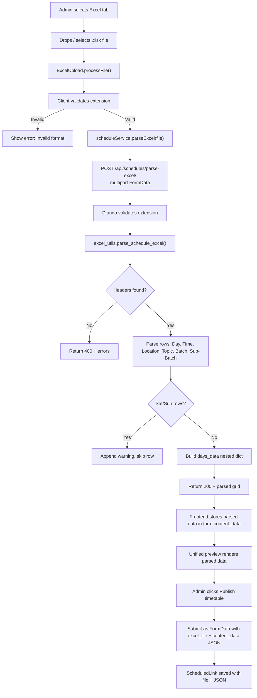
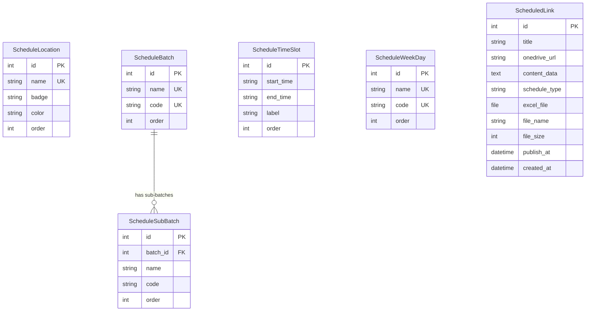
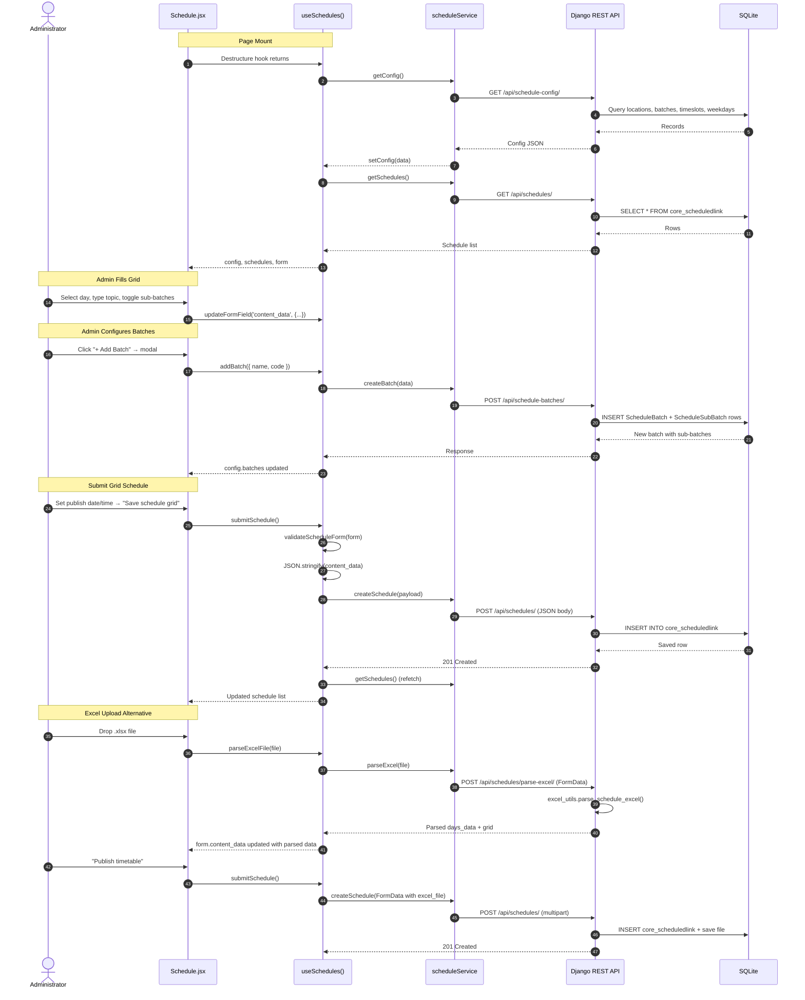

# Ignite Buddy – Schedule Module: Complete Technical Documentation

> **Status Key:** ✅ Implemented (frontend + backend) · 🟡 Frontend Only · ❌ Not Implemented

---

## Table of Contents

1. [Overview](#1-overview)
2. [Locations (7 Columns)](#2-locations-7-columns)
3. [Weekdays (Mon–Fri)](#3-weekdays-mon-fri)
4. [Dynamic Batch & Sub-Batch Management](#4-dynamic-batch--sub-batch-management)
5. [Dynamic Time-Slot Management](#5-dynamic-time-slot-management)
6. [Manual Timetable Creation (Native Grid)](#6-manual-timetable-creation-native-grid)
7. [How Manual Schedule Data Is Stored](#7-how-manual-schedule-data-is-stored)
8. [Excel Upload, Parsing & Storage](#8-excel-upload-parsing--storage)
9. [Unified Timetable Preview](#9-unified-timetable-preview)
10. [Publishing Workflow](#10-publishing-workflow)
11. [API Endpoints Reference](#11-api-endpoints-reference)
12. [Database Models & Relationships](#12-database-models--relationships)
13. [Frontend-to-Backend Data Flow](#13-frontend-to-backend-data-flow)
14. [File Inventory](#14-file-inventory)
15. [Testing](#15-testing)

---

## 1. Overview

The Schedule Module provides two ways to create campus lab timetables:

| Mode | Description | Status |
|------|-------------|--------|
| **Native Timetable Grid** | Interactive grid with 7 location columns, 5 weekday tabs, dynamic time slots, per-cell topic input and batch chip selectors | ✅ Implemented |
| **Excel File Upload** | Upload `.xlsx`/`.xls`, server-side parsing with openpyxl, validation, preview, then publish | ✅ Implemented |

Both modes share the same `ScheduledLink` model for persistence, the same unified timetable preview, and the same publish-date/time workflow.

---

## 2. Locations (7 Columns)

✅ **Implemented** – stored in `core_schedulelocation` table, seeded by migration `0004`.

| Order | Name | Badge | Color | Purpose |
|-------|------|-------|-------|---------|
| 1 | Lab 1 | Hardware | `#014BAA` | Hardware lab |
| 2 | Lab 2 | Software | `#0284C7` | Software lab |
| 3 | Lab 3 | Data & AI | `#7C3AED` | Data science / AI lab |
| 4 | Lab 4 | Cloud Ops | `#059669` | Cloud / DevOps lab |
| 5 | Work Area | Work Area | `#D97706` | Project work zone |
| 6 | TR1 | TR1 | `#EC4899` | Training Room 1 |
| 7 | TR2 | TR2 | `#8B5CF6` | Training Room 2 |

> [!NOTE]
> The legacy **Incubator** column has been fully removed from the database, frontend constants, and all grid renderers.

**Frontend fallback constants** (`constants/index.js`):

```js
export const DEFAULT_SCHEDULE_LOCATIONS = [
  'Lab 1', 'Lab 2', 'Lab 3', 'Lab 4', 'Work Area', 'TR1', 'TR2',
];
export const DEFAULT_LAB_METADATA = {
  'Lab 1':    { badge: 'Hardware',  color: '#014BAA' },
  'Lab 2':    { badge: 'Software',  color: '#0284C7' },
  'Lab 3':    { badge: 'Data & AI', color: '#7C3AED' },
  'Lab 4':    { badge: 'Cloud Ops', color: '#059669' },
  'Work Area':{ badge: 'Work Area', color: '#D97706' },
  'TR1':      { badge: 'TR1',       color: '#EC4899' },
  'TR2':      { badge: 'TR2',       color: '#8B5CF6' },
};
```

The frontend loads locations from `GET /api/schedule-config/` on mount. If the API is unreachable, these constants serve as a fallback.

---

## 3. Weekdays (Mon–Fri)

✅ **Implemented** – stored in `core_scheduleweekday` table.

| Order | Name | Code |
|-------|------|------|
| 1 | Monday | mon |
| 2 | Tuesday | tue |
| 3 | Wednesday | wed |
| 4 | Thursday | thu |
| 5 | Friday | fri |

**Saturday and Sunday are blocked at every level:**

- **Frontend:** `ScheduleGridBuilder.jsx` filters out Saturday/Sunday from the weekdays array.
- **Backend:** `ScheduleWeekDayViewSet.create()` rejects names `saturday` or `sunday` with a 400 error.
- **Excel parser:** `excel_utils.py` skips rows with Saturday/Sunday and appends a warning.

Monday is selected by default on initial load.

---

## 4. Dynamic Batch & Sub-Batch Management

✅ **Implemented** – `core_schedulebatch` and `core_schedulesubbatch` tables.

### Default Seed Data (from migration `0004`)

| Batch | Code | Sub-Batches |
|-------|------|-------------|
| Batch A | A | A1, A2, A3, A4 |
| Batch B | B | B1, B2, B3, B4 |
| Batch C | C | C1, C2, C3, C4 |

### How It Works

1. Admin clicks **`+ Add Batch`** → opens `BatchManagerModal`.
2. Frontend calls `POST /api/schedule-batches/` with `{ name, code }`.
3. Backend auto-creates 4 sub-batches by default (configurable via `subbatches_count`).
4. Frontend updates `config.batches` in React state → grid re-renders with new batch chips in every cell.

### Create Batch – Request & Response

**Request:**
```json
POST /api/schedule-batches/
{
  "name": "Batch D",
  "code": "D",
  "subbatches_count": 4
}
```

**Response (201):**
```json
{
  "id": 4,
  "name": "Batch D",
  "code": "D",
  "order": 4,
  "subbatches": [
    { "id": 13, "batch": 4, "name": "D1", "code": "d1", "order": 1 },
    { "id": 14, "batch": 4, "name": "D2", "code": "d2", "order": 2 },
    { "id": 15, "batch": 4, "name": "D3", "code": "d3", "order": 3 },
    { "id": 16, "batch": 4, "name": "D4", "code": "d4", "order": 4 }
  ]
}
```

### Add Sub-Batch – Request & Response

**Request:**
```json
POST /api/schedule-subbatches/
{
  "batch": 1,
  "name": "A5",
  "code": "a5"
}
```

**Response (201):**
```json
{ "id": 17, "batch": 1, "name": "A5", "code": "a5", "order": 5 }
```

### Validation Rules
- Duplicate batch `code` or `name` → 400 error.
- Duplicate sub-batch `code` within the same batch → 400 error.
- If `name` is omitted, auto-generated from code (e.g., `"D"` → `"Batch D"`).
- If sub-batch `name` is omitted, auto-generated (e.g., next number: `"A5"`).

### Delete
- `DELETE /api/schedule-batches/{id}/` – cascades to all sub-batches (`on_delete=CASCADE`).
- `DELETE /api/schedule-subbatches/{id}/` – removes a single sub-batch.

---

## 5. Dynamic Time-Slot Management

✅ **Implemented** – `core_scheduletimeslot` table.

### Default Seed Data

| Order | Label | Start | End |
|-------|-------|-------|-----|
| 1 | 9:00 AM – 11:00 AM | 9:00 AM | 11:00 AM |
| 2 | 11:30 AM – 1:30 PM | 11:30 AM | 1:30 PM |
| 3 | 2:00 PM – 4:00 PM | 2:00 PM | 4:00 PM |
| 4 | 4:30 PM – 6:00 PM | 4:30 PM | 6:00 PM |

### Create Time Slot – Request & Response

**Request:**
```json
POST /api/schedule-timeslots/
{
  "start_time": "6:30 PM",
  "end_time": "8:00 PM"
}
```

**Response (201):**
```json
{
  "id": 5,
  "start_time": "6:30 PM",
  "end_time": "8:00 PM",
  "label": "6:30 PM – 8:00 PM",
  "order": 5
}
```

### Edit Time Slot

```json
PATCH /api/schedule-timeslots/5/
{
  "start_time": "6:00 PM",
  "end_time": "8:30 PM",
  "label": "6:00 PM – 8:30 PM"
}
```

### Validation (Frontend)
The `validateTimeSlot()` function in `validation.js` converts times to minutes-from-midnight and checks:
- End time must be after start time.
- No overlap with existing time slots (range intersection check).

### Validation (Backend)
- Duplicate `label` → 400 error.
- `start_time` and `end_time` are required.

---

## 6. Manual Timetable Creation (Native Grid)

✅ **Implemented**

### How It Works

1. Admin selects a day tab (Monday–Friday).
2. Grid renders a table with:
   - **Rows** = time slots from `config.time_slots`
   - **Columns** = locations from `config.locations` (7 columns)
3. In each cell, admin can:
   - Type a **topic** (free-text input).
   - Toggle **sub-batch chips** (e.g., A1, A2, B3).
   - Clear all selected batches for a cell.
4. The grid state is stored in the React form as `form.content_data`:

### `content_data` JSON Structure (Native Grid)

```json
{
  "day": "Monday",
  "grid": {
    "9:00 AM – 11:00 AM": {
      "Lab 1": {
        "topic": "Digital Logic & Circuit Design",
        "subbatches": ["a1", "a2"]
      },
      "Lab 2": {
        "topic": "Full Stack React Development",
        "subbatches": ["b1", "b2", "b3"]
      },
      "Lab 3": {
        "topic": "",
        "subbatches": []
      }
    },
    "11:30 AM – 1:30 PM": {
      "Work Area": {
        "topic": "Capstone Team Sprint",
        "subbatches": ["c1", "c2", "c3", "c4"]
      }
    }
  }
}
```

**Key structure:** `grid[timeSlotLabel][locationName] → { topic: string, subbatches: string[] }`

- Time slot labels are the `label` field from `ScheduleTimeSlot` (e.g., `"9:00 AM – 11:00 AM"`).
- Location names match `ScheduleLocation.name` (e.g., `"Lab 1"`, `"TR2"`).
- Sub-batches are stored as lowercase codes (e.g., `"a1"`, `"b3"`).
- Cells with no data simply don't appear in the grid object.

### How Grid Changes Are Tracked

The `ScheduleGridBuilder` component calls `onChange({ ...value, grid: newGrid })` on every cell edit. This propagates up to `ScheduleForm` → `updateFormField('content_data', ...)` → `useSchedules` hook → React state `form.content_data`.

---

## 7. How Manual Schedule Data Is Stored

✅ **Implemented**

### Submit Flow

When the admin clicks **"Save schedule grid"**:

1. `ScheduleForm.handleSubmit()` calls `useSchedules.submitSchedule()`.
2. The hook validates the form with `validateScheduleForm()`.
3. It combines `publish_date` + `publish_time` into an ISO 8601 UTC string.
4. It builds a JSON payload:

**Actual request payload sent by `submitSchedule()`:**

```json
POST /api/schedules/
Content-Type: application/json

{
  "title": "Week 14 Schedule - Batch 50",
  "onedrive_url": "",
  "schedule_type": "grid",
  "content_data": "{\"day\":\"Monday\",\"grid\":{\"9:00 AM – 11:00 AM\":{\"Lab 1\":{\"topic\":\"Digital Logic\",\"subbatches\":[\"a1\",\"a2\"]}}}}",
  "publish_at": "2026-11-05T03:30:00.000Z"
}
```

> [!IMPORTANT]
> `content_data` is **JSON-stringified** before sending. It is stored as a `TextField` in the database, not as a native JSON field.

5. Django's `ScheduledLinkViewSet.create()` passes the data to `ScheduledLinkSerializer`.
6. The serializer validates and saves a new `ScheduledLink` row.

### Database Row (SQLite: `core_scheduledlink`)

| Column | Value |
|--------|-------|
| `id` | Auto-increment |
| `title` | `"Week 14 Schedule - Batch 50"` |
| `onedrive_url` | `""` (empty for grid type) |
| `content_data` | `'{"day":"Monday","grid":{"9:00 AM – 11:00 AM":{"Lab 1":{"topic":"Digital Logic","subbatches":["a1","a2"]}}}}'` |
| `schedule_type` | `"grid"` |
| `excel_file` | `NULL` |
| `file_name` | `NULL` |
| `file_size` | `NULL` |
| `publish_at` | `2026-11-05 03:30:00+00:00` |
| `created_at` | Auto-set on creation |

### Response (201 Created)

```json
{
  "id": 5,
  "title": "Week 14 Schedule - Batch 50",
  "onedrive_url": "",
  "content_data": "{\"day\":\"Monday\",\"grid\":{...}}",
  "schedule_type": "grid",
  "excel_file": null,
  "file_name": null,
  "file_size": null,
  "publish_at": "2026-11-05T03:30:00Z",
  "created_at": "2026-11-04T18:00:00Z"
}
```

---

## 8. Excel Upload, Parsing & Storage

✅ **Implemented**

### Step-by-Step Flow



### Excel Template Columns

Generated by `excel_utils.generate_schedule_template()`:

| Column | Description |
|--------|-------------|
| Day | Monday–Friday |
| Start Time | e.g., `9:00 AM` |
| End Time | e.g., `11:00 AM` |
| Lab / Location | Must match a valid location name |
| Topic / Subject | Free text |
| Batch | e.g., `Batch A` |
| Sub-Batch | Comma-separated codes, e.g., `A1, A2` |

### Parse Excel Response (200)

```json
{
  "success": true,
  "file_name": "schedule.xlsx",
  "file_size": 12480,
  "total_rows_parsed": 9,
  "days_found": ["Monday", "Tuesday"],
  "selected_day": "Monday",
  "days_data": {
    "Monday": {
      "9:00 AM – 11:00 AM": {
        "Lab 1": {
          "topic": "Digital Logic & Circuit Design",
          "subbatches": ["a1", "a2"]
        },
        "Lab 2": {
          "topic": "Full Stack React & Node Development",
          "subbatches": ["b1", "b2"]
        }
      },
      "11:30 AM – 1:30 PM": {
        "Lab 4": {
          "topic": "Cloud Kubernetes & DevOps CI/CD",
          "subbatches": ["a3", "a4"]
        }
      }
    },
    "Tuesday": {
      "9:00 AM – 11:00 AM": {
        "Lab 1": {
          "topic": "Microcontroller Interfacing",
          "subbatches": ["b1"]
        }
      }
    }
  },
  "grid": { "...Monday's data..." },
  "warnings": []
}
```

### Excel Parser Details (`excel_utils.parse_schedule_excel`)

1. Opens the workbook with `openpyxl.load_workbook()`.
2. Finds the first sheet named "Schedule" or "Timetable" (case-insensitive), otherwise uses the active sheet.
3. Scans the first 5 rows for header keywords (`day`, `start`, `end`, `lab`/`location`/`room`, `topic`/`subject`/`course`, `batch`, `sub-batch`).
4. Iterates data rows below the header:
   - Normalizes day names (accepts abbreviations like `Mon`, `Tue`).
   - Rejects Saturday/Sunday rows with a warning.
   - Builds time-slot labels from `start_time` and `end_time`.
   - Maps locations to valid names (case-insensitive matching against DB locations).
   - Parses sub-batches: splits on `,`, `;`, `/`, or spaces.
   - If only `Batch` is given (no sub-batch), expands to default sub-batches (e.g., `Batch A` → `a1, a2, a3, a4`).
   - Merges duplicate (day + time + location) rows, combining topics and de-duplicating sub-batches.

### Excel Storage in Database

When saved, the `ScheduledLink` row stores:

| Column | Value |
|--------|-------|
| `schedule_type` | `"excel"` |
| `content_data` | JSON string of `{ day, grid, days_data }` |
| `excel_file` | The uploaded file saved to `schedules/excels/` |
| `file_name` | Original filename |
| `file_size` | File size in bytes |

The `ScheduledLinkViewSet.create()` detects `request.FILES['excel_file']`, auto-sets `schedule_type` to `"excel"`, and populates `file_name` and `file_size`.

---

## 9. Unified Timetable Preview

✅ **Implemented** – `UnifiedTimetablePreview.jsx`

This component renders a read-only timetable table that displays **all** schedule data regardless of creation mode (native grid or Excel upload).

### Data Sources

| Mode | Data read from |
|------|----------------|
| Native Grid (single day) | `form.content_data.grid` – keyed by the selected day |
| Excel Upload (multi-day) | `form.content_data.days_data` – keyed by all parsed days |

### Features

- **Day navigation pills** with slot-count badges per day.
- **Same column layout** as the grid builder (155px time column + 145px × 7 location columns).
- Shows topic text and colored batch chips in each cell.
- Empty cells display "(Unassigned)".
- Empty state with icon when no data is configured.
- Total slot count across all days shown in header.

---

## 10. Publishing Workflow

✅ **Implemented**

### Frontend

The `ScheduleForm` provides:

- A date picker (`min` = today's date).
- A time picker.
- Quick shortcuts: **Today** (offset 0), **Tomorrow** (+1 day), **Next Week** (+7 days) – each sets the date and defaults the time to `09:00`.

The combined `publish_date + publish_time` is converted to ISO 8601 UTC by `toIsoUtcString()` from `utils/date.js`.

### Backend

The `ScheduledLink.publish_at` field is a `DateTimeField`. The model is ordered by `publish_at` ascending:

```python
class Meta:
    ordering = ['publish_at']
```

### Automated Publishing

🟡 **Frontend Only** – The "automated publishing" note in the UI states:

> *"Your schedule is stored safely. Upon reaching the chosen date and time, the timetable becomes accessible to campus students."*

Currently, there is **no backend cron job or Celery task** that automatically flips a status flag at `publish_at`. The `publish_at` field exists for informational ordering. A consumer application or future integration would query schedules where `publish_at <= now()` to surface them.

---

## 11. API Endpoints Reference

All endpoints are prefixed with `/api/` (configured in `backend/config/urls.py`).

### Schedule Configuration

| Method | Endpoint | Description | Status |
|--------|----------|-------------|--------|
| `GET` | `/api/schedule-config/` | Returns combined locations, batches (with nested sub-batches), time slots, and weekdays | ✅ |

**Response shape:**
```json
{
  "locations": [{ "id": 1, "name": "Lab 1", "badge": "Hardware", "color": "#014BAA", "order": 1 }, ...],
  "batches": [{ "id": 1, "name": "Batch A", "code": "A", "order": 1, "subbatches": [{ "id": 1, "batch": 1, "name": "A1", "code": "a1", "order": 1 }, ...] }, ...],
  "time_slots": [{ "id": 1, "start_time": "9:00 AM", "end_time": "11:00 AM", "label": "9:00 AM – 11:00 AM", "order": 1 }, ...],
  "weekdays": [{ "id": 1, "name": "Monday", "code": "mon", "order": 1 }, ...]
}
```

### Schedules (CRUD)

| Method | Endpoint | Description | Status |
|--------|----------|-------------|--------|
| `GET` | `/api/schedules/` | List all schedules (ordered by `publish_at`) | ✅ |
| `POST` | `/api/schedules/` | Create schedule (JSON body or multipart FormData with `excel_file`) | ✅ |
| `DELETE` | `/api/schedules/{id}/` | Delete a schedule | ✅ |

### Excel Operations

| Method | Endpoint | Description | Status |
|--------|----------|-------------|--------|
| `GET` | `/api/schedule-template/` | Download dynamically generated `.xlsx` template | ✅ |
| `POST` | `/api/schedules/parse-excel/` | Upload and parse `.xlsx`/`.xls` file; returns parsed grid data | ✅ |

### Batch Management

| Method | Endpoint | Description | Status |
|--------|----------|-------------|--------|
| `GET` | `/api/schedule-batches/` | List all batches with nested sub-batches | ✅ |
| `POST` | `/api/schedule-batches/` | Create batch (auto-creates sub-batches) | ✅ |
| `DELETE` | `/api/schedule-batches/{id}/` | Delete batch (cascades to sub-batches) | ✅ |
| `POST` | `/api/schedule-subbatches/` | Create a sub-batch in a batch | ✅ |
| `DELETE` | `/api/schedule-subbatches/{id}/` | Delete a sub-batch | ✅ |

### Time Slot Management

| Method | Endpoint | Description | Status |
|--------|----------|-------------|--------|
| `GET` | `/api/schedule-timeslots/` | List all time slots | ✅ |
| `POST` | `/api/schedule-timeslots/` | Create time slot (duplicate label → 400) | ✅ |
| `PATCH` | `/api/schedule-timeslots/{id}/` | Update time slot | ✅ |
| `DELETE` | `/api/schedule-timeslots/{id}/` | Delete time slot | ✅ |

### Weekday Management

| Method | Endpoint | Description | Status |
|--------|----------|-------------|--------|
| `GET` | `/api/schedule-weekdays/` | List weekdays | ✅ |
| `POST` | `/api/schedule-weekdays/` | Create weekday (Saturday/Sunday → 400) | ✅ |

---

## 12. Database Models & Relationships

All models live in `backend/core/models.py`. Database: SQLite (`backend/db.sqlite3`).



### Model Details

**`ScheduleLocation`**
- `name`: `CharField(max_length=100, unique=True)` – e.g., `"Lab 1"`, `"TR2"`
- `badge`: `CharField(max_length=100)` – display tag, e.g., `"Hardware"`
- `color`: `CharField(max_length=30)` – hex color for UI
- `order`: `IntegerField` – sort order in grid header

**`ScheduleBatch`**
- `name`: `CharField(max_length=50, unique=True)` – e.g., `"Batch A"`
- `code`: `CharField(max_length=10, unique=True)` – e.g., `"A"`
- `order`: `IntegerField` – display order

**`ScheduleSubBatch`**
- `batch`: `ForeignKey(ScheduleBatch, on_delete=CASCADE, related_name='subbatches')`
- `name`: `CharField(max_length=50)` – e.g., `"A1"`
- `code`: `CharField(max_length=20)` – lowercase identifier, e.g., `"a1"`
- `order`: `IntegerField`
- `unique_together`: `('batch', 'code')`

**`ScheduleTimeSlot`**
- `start_time`: `CharField(max_length=20)` – e.g., `"9:00 AM"` (stored as string, not `TimeField`)
- `end_time`: `CharField(max_length=20)` – e.g., `"11:00 AM"`
- `label`: `CharField(max_length=50)` – e.g., `"9:00 AM – 11:00 AM"` (auto-generated if omitted)
- `order`: `IntegerField`

**`ScheduleWeekDay`**
- `name`: `CharField(max_length=20, unique=True)` – e.g., `"Monday"`
- `code`: `CharField(max_length=10, unique=True)` – e.g., `"mon"`
- `order`: `IntegerField`

**`ScheduledLink`** – The main schedule record
- `title`: `CharField(max_length=160)` – admin-supplied title
- `onedrive_url`: `URLField(max_length=1000, blank=True, null=True)` – legacy link mode
- `content_data`: `TextField(blank=True, null=True)` – **JSON string** of the timetable grid
- `schedule_type`: `CharField(max_length=20, default='grid')` – values: `'grid'`, `'excel'`, `'link'`
- `excel_file`: `FileField(upload_to='schedules/excels/')` – uploaded Excel file (null for grid mode)
- `file_name`: `CharField(max_length=255)` – original filename of uploaded Excel
- `file_size`: `IntegerField` – file size in bytes
- `publish_at`: `DateTimeField` – scheduled publication timestamp
- `created_at`: `DateTimeField(auto_now_add=True)` – record creation timestamp

> [!IMPORTANT]
> Schedule data (topics and batch assignments) is **not** stored as relational rows per time slot per location. It is stored as a single JSON string in `content_data`. The configuration tables (`ScheduleLocation`, `ScheduleBatch`, etc.) provide the **metadata** that drives the UI, but the actual per-cell schedule assignments live as a JSON blob.

---

## 13. Frontend-to-Backend Data Flow

### Full Lifecycle Diagram



### Component Hierarchy

```
Schedule.jsx (page)
└── ScheduleForm.jsx (form + tabs)
    ├── ScheduleGridBuilder.jsx (native grid tab)
    │   ├── BatchManagerModal.jsx (add/remove batches)
    │   └── TimeSlotManagerModal.jsx (add/edit/remove time slots)
    ├── ExcelUpload.jsx (excel tab)
    └── UnifiedTimetablePreview.jsx (read-only preview, both modes)
```

### State Management

There is no global state library (Redux, Zustand, etc.). All state is managed through the `useSchedules()` custom hook, which returns:

| Return Value | Type | Purpose |
|-------------|------|---------|
| `schedules` | `array` | List of saved ScheduledLink records |
| `loading` | `boolean` | Whether schedules are being fetched |
| `configLoading` | `boolean` | Whether config is loading |
| `config` | `object` | `{ locations, batches, time_slots, weekdays }` |
| `form` | `object` | Current form state |
| `formErrors` | `object` | Field-level validation errors |
| `isSubmitting` | `boolean` | Submission in progress |
| `error` | `string` | General error message |
| `updateFormField` | `function` | Update a single form field |
| `resetForm` | `function` | Reset form to initial state |
| `submitSchedule` | `function` | Validate and POST the schedule |
| `deleteSchedule` | `function` | DELETE a schedule by ID |
| `addBatch` | `function` | POST new batch to API + update config |
| `removeBatch` | `function` | DELETE batch from API + update config |
| `addSubBatch` | `function` | POST new sub-batch to API + update config |
| `removeSubBatch` | `function` | DELETE sub-batch from API + update config |
| `addTimeSlot` | `function` | POST new time slot + update config |
| `editTimeSlot` | `function` | PATCH time slot + update config |
| `removeTimeSlot` | `function` | DELETE time slot + update config |
| `parseExcelFile` | `function` | Upload Excel, parse, and set form.content_data |

---

## 14. File Inventory

### Frontend (15 files)

| File | Purpose |
|------|---------|
| `src/pages/Schedule/Schedule.jsx` | Page layout, hook integration, tab state |
| `src/components/schedule/ScheduleForm.jsx` | Tab switcher (Grid / Excel / Link), title input, publish settings, submit |
| `src/components/schedule/ScheduleGridBuilder.jsx` | Interactive grid table: day pills, time-slot rows, 7 location columns, sub-batch chips |
| `src/components/schedule/BatchManagerModal.jsx` | Modal for creating/deleting batches and sub-batches |
| `src/components/schedule/TimeSlotManagerModal.jsx` | Modal for adding/editing/deleting time slots with overlap validation |
| `src/components/schedule/ExcelUpload.jsx` | Drag-and-drop file upload, template download, file card, parse integration |
| `src/components/schedule/UnifiedTimetablePreview.jsx` | Read-only timetable preview for both grid and Excel data |
| `src/components/schedule/SchedulePreviewModal.jsx` | Full-screen preview dialog |
| `src/components/schedule/DeleteScheduleDialog.jsx` | Confirmation dialog for deleting schedules |
| `src/components/schedule/ScheduleList.jsx` | Upcoming schedule cards list |
| `src/hooks/useSchedules.js` | Custom hook: state, API calls, CRUD for batches/timeslots/schedules |
| `src/services/scheduleService.js` | API client wrapper for all schedule endpoints |
| `src/constants/index.js` | Default locations (7), days (5), time slots (4), batch groups, validation limits |
| `src/utils/validation.js` | `validateScheduleForm()`, `validateTimeSlot()`, `timeStringToMinutes()` |
| `src/styles.css` | All schedule-related CSS (grid layout, batch chip colors, dropzone, modals) |

### Backend (8 files)

| File | Purpose |
|------|---------|
| `backend/core/models.py` | `ScheduleLocation`, `ScheduleBatch`, `ScheduleSubBatch`, `ScheduleTimeSlot`, `ScheduleWeekDay`, `ScheduledLink` |
| `backend/core/serializers.py` | DRF serializers for all schedule models |
| `backend/core/views.py` | ViewSets + function-based views: `schedule_config_view`, `schedule_excel_template_view`, `schedule_parse_excel_view` |
| `backend/core/urls.py` | Router registrations + explicit paths |
| `backend/core/excel_utils.py` | `generate_schedule_template()`, `parse_schedule_excel()` |
| `backend/core/tests.py` | 5 test cases covering config, batches, timeslots, weekday rejection, Excel round-trip |
| `backend/core/migrations/0003_...` | Schema migration: creates schedule config tables + extends ScheduledLink |
| `backend/core/migrations/0004_seed_schedule_defaults.py` | Data migration: seeds 7 locations, 3 batches (12 sub-batches), 4 time slots, 5 weekdays |

---

## 15. Testing

### Frontend (Vitest)

```bash
cd frontend
npm test
```

Test file: `src/test/scheduleEnhancements.test.jsx`

Tests verify:
- Grid renders 7 location columns (no Incubator).
- Only Monday–Friday day pills are displayed.
- Sub-batch chips (A1, A2, etc.) render in schedule cells.
- Quick-selection chips (`+ All A`, `+ All B`, etc.) are removed.
- Dynamic batch/time-slot management buttons exist.

### Backend (Django)

```bash
cd backend
python manage.py test core
```

Test file: `backend/core/tests.py` – 5 test cases:

| Test | Validates |
|------|-----------|
| `test_schedule_config_endpoint` | 7 locations returned, no Incubator; 5 weekdays, no Sat/Sun |
| `test_dynamic_batch_and_subbatch_creation` | Create Batch D with auto-subs; add D4; reject duplicate code |
| `test_dynamic_timeslot_creation` | Create custom time slot |
| `test_reject_saturday_weekday` | POST Saturday → 400 |
| `test_excel_template_download_and_parsing` | Download template → parse it → verify rows extracted |

---

*Documentation updated 2026-11-04. Based on actual source code inspection of all frontend components, backend views, models, serializers, migrations, and utility files.*
